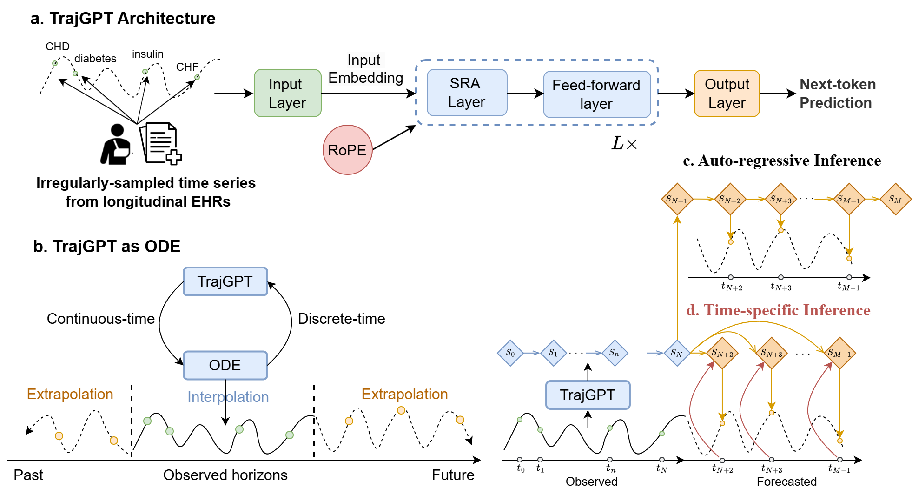

# TrajGPT

Code for **[TrajGPT: Irregular Time-Series Representation Learning of Health Trajectory](https://doi.org/10.1109/JBHI.2025.3620205)**.

**Ziyang Song, Qincheng Lu, He Zhu, David Buckeridge, and Yue Li**

*IEEE Journal of Biomedical and Health Informatics*, 30(5):3888–3899, 2026. First published online in October 2025.

[Journal paper](https://doi.org/10.1109/JBHI.2025.3620205) · [arXiv preprint](https://arxiv.org/abs/2410.02133) · [Usage](#installation) · [Citation](#citation)

## Overview

Trajectory Generative Pre-trained Transformer (TrajGPT) learns representations of longitudinal health records with irregular observation times. Its Selective Recurrent Attention (SRA) uses context-dependent decay to retain relevant history. The paper also develops an ODE-based interpretation for time-specific trajectory inference.



### Current training and inference workflow

The commands below use historical-time rotary position embeddings (RoPE), target-time conditioning, and **autoregressive PheCode prediction at supplied future times**:

$$
P(x_{n+1}\mid x_{1:n}, t_{1:n}, t_{n+1}).
$$

- **Training:** teacher forcing with real preceding events and their own timestamps; cross-entropy loss predicts the next PheCode. Right-side padding is masked and excluded from the loss.
- **Time:** historical timestamps enter RoPE. The output layer also uses the gap between the target time and the last input event. All times are in months; equal timestamps are allowed.
- **Inference:** load a pretrained checkpoint, predict one PheCode, append it with its supplied query time, and repeat. Each step recomputes the current history and retains the most recent events when the window is full.

This workflow predicts **which PheCode occurs at each given query time**. It does not predict event times or the number of future events. The documented inference entry point uses greedy autoregression without a recurrent cache; it does not implement the paper's ODE-inspired inference procedure. These commands demonstrate the current implementation, rather than reproduce all experiments in the paper.

## Installation

The dependency versions in `requirements.txt` were tested with Python 3.13.5. From a terminal:

```bash
git clone https://github.com/li-lab-mcgill/TrajGPT.git
cd TrajGPT
python3 -m venv .venv
source .venv/bin/activate
python -m pip install -r requirements.txt
```

Run the following commands from the repository root. `--device auto` selects CUDA, then Apple MPS, then CPU, according to availability. You can also set `--device cpu`, `--device cuda`, or `--device mps`. Workflow validation has been performed on CPU; GPU and MPS execution have not been verified.

## Data preparation

**Patient data, PheCode embedding files, and pretrained checkpoints are not distributed in this repository.** Supply your local files before training:

| Local file | Purpose |
| --- | --- |
| `data/processed_pophr_data.csv` | One row per patient event; required for training and test-patient evaluation |
| `data/phecode_embeddings.csv` | Fixed 200-dimensional PheCode vectors; required for a new training run |
| `data/phecode_definitions1.2.csv` | Optional `phecode` and `phenotype` columns for readable disease names |

The processed patient CSV must contain:

| Column | Meaning |
| --- | --- |
| `id` | Patient identifier |
| `date` | Event date, used to sort each patient's records |
| `PheCode` | Positive integer code present in the embedding vocabulary |
| `age_at_diag` | Age at the event, in months; nonnegative and nondecreasing within the sorted history |

The embedding CSV uses its first column as the PheCode index and the remaining 200 columns as numeric vector values. Codes must use the same integer representation as the patient CSV. Do not round decimal PheCodes to make them fit this format. `0` is reserved for padding and `-1` for the start token; neither belongs in clinical records.

The current loader reads only the **first 10,000 rows**, then creates patient-level train/validation/test splits of approximately 80%/10%/10% using split seed 42. This row limit can cut off a patient's records. Training keeps at most the latest 256 target events per patient, with event times truncated together. The row limit and sequence length remain fixed in this workflow.

## Pretraining

Start a short two-epoch run:

```bash
python run_pretrain.py \
  --time_mode time_conditioned \
  --time_scale 1.0 \
  --device auto \
  --batch_size 8 \
  --train_epochs 2 \
  --learning_rate 0.00003 \
  --run_name pretrain_demo
```

The default model uses four SRA layers, four heads, and fixed 200-dimensional embeddings. Historical events and their timestamps shift together exactly once during teacher forcing; target events and target times remain aligned. The most recent event is the final training label and becomes part of the history when generating its successor.

Outputs are saved under `checkpoints/pretrain_demo/`:

| File | Contents |
| --- | --- |
| `last.pt` | Checkpoint from the latest completed epoch |
| `best.pt` | Checkpoint with the lowest validation loss |
| `config.json` | Model, temporal, and training settings |
| `split_ids.json` | Patient IDs assigned to each split |
| `history.json`, `train.log` | Per-epoch training and validation losses and run details |

Checkpoints contain model weights, fixed embeddings, vocabulary, optimizer state, training progress, random states, and patient splits. Loading a checkpoint for inference does not require the original embedding CSV.

Use a new run name for each run, or omit `--run_name` to create a unique directory automatically. A short run checks that the workflow executes; it does not establish predictive performance.

### Resume training

```bash
python run_pretrain.py \
  --resume checkpoints/pretrain_demo/last.pt \
  --train_epochs 3 \
  --device auto \
  --run_name pretrain_resumed
```

`--train_epochs 3` means three epochs in total. If the checkpoint completed epoch 2, this runs epoch 3. Resume restores the saved model, optimizer, temporal settings, and patient splits, and writes to a new directory. Keep the processed data unchanged so the saved splits remain valid. A resumed run writes `best.pt` only if validation improves over the saved best loss; `last.pt` is always written after a completed epoch.

## Inference and evaluation

### Predict the sequence after the first 50 events

```bash
python run_inference.py \
  --checkpoint checkpoints/pretrain_demo/best.pt \
  --prefix_length 50 \
  --top_k 5 \
  --device auto \
  --output results/prefix50.json
```

The script selects the longest patient sequence with more than 50 events in the checkpoint's saved test split. It uses the first 50 PheCodes and their timestamps as observed history. The remaining recorded timestamps are supplied as future queries; **the remaining true PheCodes are used only for evaluation after generation**.

For each query, `TrajGPT.inference()` selects the highest-scoring valid PheCode, appends that prediction and its query time to the history, and predicts the next event. PAD cannot be generated. The 256-position inference window includes SOS and up to 255 recent events. Query times can be unevenly spaced or repeated.

By default, all remaining query times are evaluated. Add `--max_new_tokens 50` to cap generation at 50 events; fewer are generated if the sequence has fewer remaining queries. `--patient_index` selects a particular index in the sorted test split, not a patient ID.

The script writes `results/prefix50.json` and `results/prefix50.csv`, including query times, predicted codes, optional disease names, top-k probabilities, and comparison with true codes. It reports top-1/top-k accuracy and cumulative accuracy at several horizons. `--top_k` controls reported candidates; generation still uses the top-1 prediction. Choose a new output filename for each run.

This is **conditional trajectory evaluation given future event times**. It is not an evaluation of predicting when events occur.

### Load a pretrained model in Python

The same model class and pretrained output head are used for inference:

```python
from training_utils import load_checkpoint
from run_inference import select_test_patient

model, checkpoint = load_checkpoint(
    "checkpoints/pretrain_demo/best.pt", device="auto"
)
events, times, selection = select_test_patient(
    checkpoint,
    context_length=checkpoint["config"]["seq_len"],
    prefix_length=50,
)

predictions = model.inference(
    history_codes=events[:50],
    history_times=times[:50],
    future_times=times[50:],
    top_k=5,
)
print(predictions["phecodes"])
print(predictions["times"])
```

For your own history, replace those three input lists with known PheCodes, their timestamps, and your future query times. Supply no SOS or PAD tokens. The first query must be at or after the last history time, and query times must be nondecreasing. Each query produces one PheCode. Direct inference with supplied lists needs only the compatible checkpoint; the test-patient selection helper additionally needs the patient CSV.

Only checkpoints produced by the current checkpoint workflow are supported; older weight-only files are not automatically migrated. Historical-time conditioning requires a model pretrained with `time_conditioned`.

## Notebook

[`notebook.ipynb`](notebook.ipynb) walks through data inspection, optional training, checkpoint loading, and trajectory evaluation. Open it in a Jupyter-compatible editor with the installed Python environment and the repository root as the working directory.

On a fresh checkout, set `RUN_PRETRAIN = True` to train a model, or set `CHECKPOINT` to your own compatible checkpoint. The notebook's example checkpoint path is local and is not included in the repository.

## Code organization

| File | Role |
| --- | --- |
| `data/data_pipeline.py` | Patient splits, event/time alignment, teacher forcing, and padding |
| `models/TrajGPT.py` | Model forward pass and `TrajGPT.inference()` |
| `layers/` | SRA, embeddings, and time RoPE |
| `run_pretrain.py` | Pretraining and resume entry point |
| `training_utils.py` | Device selection and checkpoint save/load |
| `run_inference.py` | Autoregressive inference and test-patient evaluation |
| `run_generate.py` | Compatibility entry point; use `run_inference.py` for the current workflow |
| `tests/` | Synthetic workflow, temporal alignment, and inference tests |

Run the synthetic checks without PopHR data or pretrained weights:

```bash
python -m pytest -q -p no:cacheprovider \
  tests/test_basic_workflow.py \
  tests/test_time_pretraining.py \
  tests/test_time_inference.py
```

Data files, checkpoints, and generated evaluation results are excluded from Git. Keep notebook execution outputs local because they can contain patient records or predictions.

## Citation

If you use TrajGPT in your research, please cite the journal paper:

```bibtex
@article{song2026trajgpt,
  title   = {{TrajGPT}: Irregular Time-Series Representation Learning of Health Trajectory},
  author  = {Song, Ziyang and Lu, Qincheng and Zhu, He and Buckeridge, David and Li, Yue},
  journal = {IEEE Journal of Biomedical and Health Informatics},
  year    = {2026},
  volume  = {30},
  number  = {5},
  pages   = {3888--3899},
  doi     = {10.1109/JBHI.2025.3620205}
}
```
